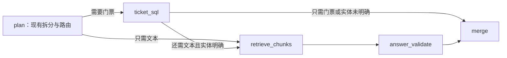

# LangGraph最小工具图：M1—M4

新代码已部署到原RAG进程，通过独立RAG_LANGGRAPH_ENABLED开关接入/ask。没有恢复旧规划应用、旧表、旧HTTP500入口或旧LangGraph图；本阶段从冻结mixed v1能力新建流程。

## M1：图骨架

`rag/service/ask_graph.py`使用TypedDict状态和五个节点：plan、ticket_sql、retrieve_chunks、answer_validate、merge。计划沿用build_mixed_plan和现有规则/语义分类器；不增加LLM planner或LLM分类。

SQL单路径只执行plan→ticket_sql→merge，跳过检索和生成；RAG单路径跳过SQL。混合路径先查SQL定位实体，再用景点名与文本子问题检索。已有查询向量传给原search，不再次编码。图无循环、无checkpointer或持久化会话。

## M2：工具契约

`rag/service/graph_tools.py`提供TicketInput、RetrieveInput和ToolOutput。两个适配器仅调用现有try_ticket_answer和search，没有复制SQL、表访问、编码或排序实现。

状态保持not_queried、query_failed、queried_no_evidence、queried_with_evidence。结构化输出携带tool_called、query_executed、reason、evidence_ids、retrieved_count及原工具payload，保留引用、SQL原文、来源与采集时间。

retrieved_count记录候选片段数；候选片段不自动视作当前需求的证据。answer_validate调用现有answer_question，完成原文引用校验后再确认RAG取证状态。第29题可以retrieved_count>0，但没有支持轮椅设施的引用，最终queried_no_evidence。

图模式/ask新增workflow=langgraph_v1、node_trace和tool_results，同时保留原route、required_stores、tasks、structured_data、citations、retrieved_sources、warnings。tasks还列出跳过的工具，state=not_queried、reason=not_required。

## M3：开关与失败隔离

RAG_LANGGRAPH_ENABLED=1服务器启用图；设为0并重启完全走原/ask代码。关闭时连新增图响应字段也不输出，原混合与单路径行为保留。/search不进入图，不产生图字段。

工具/生成异常记为query_failed，返回可解释的局部不足，异常内容不暴露。SQL失败仍查询文本；检索或生成失败仍保留SQL原文。实体未唯一定位时，已读目录不等于执行票价字段查询，SQL state=not_queried，并跳过混合文本查询以防景点混用。

## M4：验证结果

- 首轮50项测试通过；之后补充关闭开关时的响应字段兼容测试，完整51项通过。
- 27—30四题在线检查通过：SQL价格原文与数据库对照、RAG引用摘录与文本核对、工具调度和节点顺序符合计划。29只对轮椅部分无法确认。
- 30题挑战集的26道单路径路径、上下文和structured_data不变；25题回答集路径与Top5上下文不变。
- 73题/search Top20的片段ID、顺序及相似度逐项完全一致。
- 55次回归/ask的图调度均检查：单路径没有调用不需要的工具，每个实际节点只执行一次。
- 多景点混合冒烟请求说明单景点限制，SQL字段查询与文本检索均未执行。
- “给我安排洛阳一日游”跑通plan→检索→回答校验→合并，但当前片段不足以支持一日游安排，返回无法确认。仅验证端到端与不足处理，不计为行程规划完成；该答复的人工评分为空。

完整回归报告 `rag/eval/reports/langgraph_v1_live_run1.json/.md` 保留首轮50项测试对应版本。只补强响应序列化兼容后，又通过51项测试及四题/额外冒烟复验，记录 `langgraph_v1_schema_followup.json/.md`。序列化补强不修改工具调用、查询、Prompt或向量排序；未覆盖初次结果。

所有本轮新答案human_review仍为空，包括27—30；不继承mixed v1四题用户分数。30题为合成挑战集，不代表真实用户盲测或整体准确率。工具调度检查与答案人工质量评审分开。

## 依赖与版本

服务器原本仍安装LangGraph 1.2.14，但旧应用删除后已没有依赖声明。新增 `rag/requirements-langgraph.txt` 固定已验证版本，没有升级已有库。图关闭时不导入LangGraph，缺该依赖也不会影响原问答路径。

实现依据为官方 [StateGraph文档](https://reference.langchain.com/python/langgraph/graph/state/StateGraph) 与 [Pydantic序列化文档](https://docs.pydantic.dev/latest/concepts/serialization/)。

## 留档与回退

mixed v1冻结快照保持不变。图候选源码、依赖声明、测试/报告与摘要另存 `rag/eval/baselines/langgraph_candidate_v1/`，尚未获人工验收，不称为已验收图基线。

部署前服务入口备份 `deploy/backups/langgraph-2026-10-12/retrieval_server.py`；设置图开关为0并重启可恢复当前原问答行为。没有复制.env或密钥。服务器仍仅监听127.0.0.1:8100。

此阶段已实现受限工具编排；通用自主规划、补查/重规划、行程可行性校验、多景点编排、多轮状态和地图/天气尚未实现。
